# 🌌 DeveloperDesktop

<div align="center">

[-success?style=for-the-badge&logo=githubactions&logoColor=white)](.github/workflows/ci.yml)
[](install.sh)
[](.config/hypr/hyprland.conf)
[](.config/kitty/kitty.conf)
[](themes/nordic-charcoal.json)
[](LICENSE)

**A keyboard-driven developer workstation designed to be fast, clean, and distraction-free.**

[About](#-about) • [Visual Preview](#-visual-preview) • [Features](#-features) • [Quick Start](#-quick-start) • [Keyboard Shortcuts](#-keyboard-shortcuts) • [Developer Suite](#-developer-suite) • [Architecture](#-architecture)

</div>

---

## 💡 About

**DeveloperDesktop** turns any Linux distribution or Windows WSL2 setup into a unified, high-performance developer cockpit.

Instead of clicking through menus and dragging windows around, you control your entire workflow with intuitive keyboard shortcuts. Every part of the system—from your code editor and terminal to the status bar and application launcher—shares the same soothing dark aesthetic (**Nordic Charcoal**), giving you a focused, beautiful environment for writing code.

Whether you run modern Wayland with **Hyprland** or traditional X11 / Remote Desktop / WSL2 with **i3**, everything looks and works identically.

---

## 📸 Visual Preview

<div align="center">

### 🖥️ Tiled Developer Workstation
*8px margins, Neovim code editor on the left, Kitty GPU terminal with Starship prompt and Fastfetch system banner on the right, and an island status bar on top.*


<br/>

###  Spotlight Application & Project Launcher
*Press `Super + Space` to fuzzy search and launch your applications, code repositories, or commands instantly.*


</div>

---

## ✨ Features

* 🎨 **Cohesive Design System:** Every tool uses the Nordic Charcoal palette (`themes/nordic-charcoal.json`). Deep obsidian dark surfaces (`#11111b`) paired with crisp Ice Cyan (`#89dceb`) and soft text (`#cdd6f4`).
* ⌨️ **Ergonomic Shortcuts:** Common muscle-memory keybindings for terminal, app launcher, window navigation, workspaces 1–9, and screenshots.
* ⚡ **Lightning-Fast System Stats:** A custom lightweight script (`scripts/sys_metrics.sh`) monitors CPU, RAM, and Battery directly from Linux `/proc` in microseconds with zero system lag.
* 🖼️ **Dynamic Wallpaper Theming:** Automatically extracts color harmony from your wallpaper and live-reloads window borders, status bars, and notifications on the fly.
* 🚀 **Smart Workspace Routing:** Windows automatically go where they belong—Code editors on Workspace 1, Browsers on Workspace 2, Chat on Workspace 4, and Music on Workspace 5.
* 🧰 **Built-in Developer Tools:**
  * **Quake Dropdown Terminal:** Press `Super + ~` to drop down a floating terminal from the top edge for quick git commands.
  * **Project Picker:** Press `Super + O` to fuzzy search your code repositories and open them in your editor and terminal.
  * **Shortcuts Cheatsheet:** Press `Super + Shift + /` to open an interactive searchable cheatsheet of all keybindings.
  * **Power Menu:** Press `Super + Shift + E` to quickly lock, suspend, log out, reboot, or power off.
* 🛡️ **Safe, 1-Command Installer:** Works smoothly on Arch Linux, Ubuntu, Debian, and Fedora. Includes `--dry-run` to preview actions safely and `--rollback` to restore your previous files whenever you want.

---

## ⚡ Quick Start

### On Linux (Arch, Ubuntu, Debian, Fedora)

Run these three commands in your terminal:

```bash
# 1. Clone the repository
git clone https://github.com/ShaanAhamedM/DeveloperDesktop.git
cd DeveloperDesktop

# 2. Make installer executable
chmod +x install.sh

# 3. Run installation
./install.sh
```

#### Handy Installation Options:
```bash
# Safely simulate the install without modifying any files
./install.sh --dry-run

# Fast non-interactive install (ideal for Docker containers or CI)
./install.sh --no-deps -y

# Undo installation and restore your previous config files
./install.sh --rollback
```

---

### On Windows 11 / WSL2 (1-Click Instant Preview)

You can experience the full Linux desktop directly inside a native window on Windows:

1. Double-click **`launch_desktop.bat`** in the repository root.
2. An isolated 1600x900 Linux developer workstation opens on your Windows screen via WSLg!
3. Or test individual tools directly from PowerShell:
   ```powershell
   wsl bash scripts/sys_metrics.sh --all
   wsl kitty
   ```

---

## ⌨️ Keyboard Shortcuts

> 💡 **Tip:** The **`Super` key** is the **Windows Key (⊞)** on your keyboard!

| Shortcut | Action | Description |
| :--- | :--- | :--- |
| `Super + Return` | **Open Terminal** | Launches GPU-accelerated Kitty terminal |
| `Super + Space` | **App Launcher** | Spotlight fuzzy search for apps and tools |
| `Super + D` | **App Launcher (Alias)**| Standard window-manager alias for launcher |
| `Super + W` | **Window Switcher** | Fuzzy search and jump between open windows |
| `Super + M` | **System Monitor** | Instant floating `btop` dashboard |
| `Super + O` | **Project Picker** | Fuzzy search code repositories and open in editor |
| `Super + Q` | **Close Window** | Closes the currently active window |
| `Super + F` | **Fullscreen** | Expands current window to fill screen |
| `Super + V` | **Toggle Floating** | Detaches window from tiling grid |
| `Super + S` | **Toggle Split** | Toggles horizontal vs vertical split orientation |
| `Super + ~` (grave) | **Dropdown Terminal** | Quake-style floating terminal from the top edge |
| `Super + 1 .. 9` | **Switch Workspace** | Jump directly to Workspaces 1 through 9 |
| `Super + Shift + 1 .. 9` | **Move Window** | Move active window to target Workspace |
| `Super + H / J / K / L` | **Focus Window** | Vim-style directional window navigation |
| `Print` or `Super + Shift + S` | **Screenshot Area** | Select a region and copy screenshot to clipboard |
| `Super + Ctrl + S` | **Screenshot Full** | Save full-screen capture to `~/Pictures/Screenshots` |
| `Super + Shift + /` | **Cheatsheet** | Opens interactive searchable shortcuts modal |
| `Super + Shift + E` | **Power Menu** | Quick Lock, Suspend, Logout, Reboot, or Shutdown |

---

## 🧰 Developer Suite

DeveloperDesktop comes configured with a cohesive set of development tools:

* **⚡ Minimalist Neovim (`.config/nvim/init.lua`):** Starts in under 10ms with zero external plugin dependencies. Features hybrid line numbers, Nordic Charcoal syntax highlighting, custom statusline, Netrw file explorer (`Space + e`), and Vim navigation.
* **🪟 Themed Tmux (`.config/tmux/tmux.conf`):** 1-based indexing, true 24-bit color, vi copy mode, fast `Alt + h/j/k/l` pane navigation without prefix, and a clean top status bar.
* **🚀 Starship Prompt (`.config/starship.toml`):** Clean two-line prompt showing directory path, git branch and status (staged, modified, untracked), command execution time, and exit status.
* **📊 Fastfetch Banner (`.config/fastfetch/config.jsonc`):** Clean ASCII system specs displayed when opening new terminals.
* **🐚 Shell Environment (`.config/shell/developer_environment.sh`):** Helpful modern aliases (`top` -> `btop`, `cat` -> `bat`), git productivity aliases (`gs`, `ga`, `gc`, `gp`, `gd`), and path configuration.

---

## 📊 Lightweight System Metrics

The custom system metrics monitor (`scripts/sys_metrics.sh`) is designed to give you instant stats without burning battery or CPU cycles:

* **Sub-Millisecond CPU:** Reads `/proc/stat` directly and calculates usage without spawning `top`.
* **Microsecond Memory:** Directly reads `/proc/meminfo`.
* **Smart Detection:** Automatically shows laptop battery levels (`BAT*`). On desktops or virtual machines, it cleanly switches to showing available root storage.
* **Instant Event Refresh:** When clicked in your status bar, it sends a real-time signal (`SIGRTMIN+8`), refreshing the display immediately.

```bash
# Print a clean summary report
bash scripts/sys_metrics.sh --all

# Print single-line format for status bars
bash scripts/sys_metrics.sh --bar

# Print JSON format for Waybar or custom widgets
bash scripts/sys_metrics.sh --json

# Trigger an immediate bar refresh
bash scripts/sys_metrics.sh --refresh
```

---

## 📐 Architecture

All configurations are modular, declarative, and connect to a single palette specification:

```mermaid
flowchart TD
    Theme["themes/nordic-charcoal.json\n(Single Source of Truth Palette)"]
    
    subgraph Window Management
        Hypr["Wayland: Hyprland"]
        I3["X11 / WSL2: i3"]
        Bar["Status Bar: Waybar & i3bar"]
        Menu["Launcher: Rofi"]
        Notify["Notifications: Dunst"]
    end

    subgraph Developer Suite
        Term["Terminal: Kitty"]
        Mux["Multiplexer: Tmux"]
        Editor["Editor: Neovim"]
        Prompt["Prompt: Starship"]
        Banner["System Info: Fastfetch"]
    end

    subgraph Custom Scripts
        Metrics["sys_metrics.sh\n(Direct /proc reader + RTMIN+8 signal)"]
        ThemeSync["theme_sync.sh\n(Wallpaper color extraction & live reload)"]
        Scratchpad["scratchpad.sh\n(Quake dropdown toggle)"]
        Cheatsheet["cheat_sheet.sh\n(Searchable shortcut finder)"]
        Projects["project_picker.sh\n(Developer repo switcher)"]
    end

    Theme --> Term
    Theme --> Menu
    Theme --> Bar
    Theme --> Hypr
    Theme --> I3
    Theme --> Notify
    Theme --> Editor
    Theme --> Mux
    Theme --> Prompt

    Metrics --> Bar
    ThemeSync --> Hypr
    ThemeSync --> I3
    ThemeSync --> Bar
```



---

## 🤝 Community & Contributing

Contributions, feedback, and suggestions are warmly welcomed!
* Review our [Contributing Guide](CONTRIBUTING.md) for details on code style.
* Read our [Code of Conduct](CODE_OF_CONDUCT.md).
* Report bugs or request features using our [Issue Templates](.github/ISSUE_TEMPLATE/).

---

## 📄 License & Author

This project is open-source software licensed under the [MIT License](LICENSE).

Crafted and maintained with precision by **Shaan** ([@ShaanAhamedM](https://github.com/ShaanAhamedM)).
