# 🌌 DeveloperDesktop

<div align="center">

[-success?style=for-the-badge&logo=githubactions&logoColor=white)](.github/workflows/ci.yml)
[](scripts/test_desktop.py)
[](install.sh)
[](.config/hypr/hyprland.conf)
[](.config/kitty/kitty.conf)
[](themes/nordic-charcoal.json)
[](LICENSE)

**A keyboard-driven, minimalist developer cockpit designed with mathematical symmetry and zero bloat.**

[Features](#-core-features--bonus-highlights) • [Architecture](#-architecture) • [Developer Cockpit](#-developer-cockpit-suite) • [Keyboard Shortcuts](#-keyboard-shortcuts-reference) • [Installation](#-enterprise-one-command-installer) • [Automated Testing](#-automated-testing--ci)

</div>

---

## 🎯 Overview

**DeveloperDesktop** turns any Linux workstation or WSL2 environment into a cohesive, high-performance developer cockpit. Designed under strict minimalist principles:

* **8-Point Grid Symmetry:** Uniform 8px spacing across all tiled windows, status island pills, and floating modals.
* **Nordic Charcoal Spec:** Deep obsidian surfaces (`#11111b`) accented with crisp Ice Cyan (`#89dceb`) and muted slate (`#6c7086`).
* **Sub-Millisecond Performance:** Zero-lag GPU terminal rendering and direct `/proc` metric parsing.
* **Universal Parity:** Native Wayland support (Hyprland + Waybar) with drop-in X11 / Remote Desktop compatibility (i3 + Xephyr).
* **Enterprise Idempotency:** Non-destructive installation with atomic backups, dry-run simulation, and instant rollback.

---

## 📸 Visual Showcase

<div align="center">

### 🖥️ Tiled Developer Workstation (`i3` / `Hyprland` with 8px Gaps & `btop`)


###  Spotlight Application Launcher (`Rofi` in Nordic Charcoal)


</div>

---

## 🚀 Core Features & Bonus Highlights

| Feature | Requirement | Description |
| :--- | :---: | :--- |
| **Unified Visual Theme** | Core #1 | Single source of truth palette (`themes/nordic-charcoal.json`) shared across Terminal, Launcher, Status Bar, Window Borders, Neovim, and Tmux. |
| **Ergonomic Shortcuts** | Core #2 | Muscle-memory keybindings for terminal, launcher, workspaces, floating windows, and screenshots. |
| **Refreshable Metrics Engine** | Core #3 | Custom Bash script (`scripts/sys_metrics.sh`) parsing `/proc/stat` and `/proc/meminfo` with laptop battery detection and desktop storage fallback. |
| **Dynamic Theming Engine** | Bonus | `scripts/theme_sync.sh` extracts color harmony from wallpapers and broadcasts live IPC reload signals without restarting your session. |
| **Auto Workspace Routing** | Bonus | Declarative window rules allocating IDEs to WS 1, Browsers to WS 2, Communication to WS 4, and Media to WS 5. |
| **Interactive Status Bar** | Bonus | Clickable Waybar island modules (click CPU/RAM for `btop`, click Volume for `pavucontrol`, right-click for instant metric refresh). |
| **Quake Dropdown Terminal** | Bonus | `Super + ~` drops a floating terminal from the top of the monitor for quick git commands and tests. |
| **Searchable Cheatsheet** | Bonus | `Super + Shift + /` pops up a fuzzy searchable modal listing all system keybindings. |
| **Project Workspace Switcher**| Bonus | `scripts/project_picker.sh` fuzzy finds code repositories and launches VS Code + Kitty in a dedicated workspace. |
| **Enterprise Installer** | Bonus | `install.sh` with `--dry-run`, `--rollback`, non-interactive mode, and auto-backup for Arch, Debian, Ubuntu, and Fedora. |

---

## 📐 Architecture

```mermaid
flowchart TD
    Theme["themes/nordic-charcoal.json\n(Single Source of Truth)"]
    
    subgraph Core Window Management
        Hypr["Compositor: Hyprland (Wayland)"]
        I3["Compositor: i3 (X11 / WSLg)"]
        Bar["Status Bar: Waybar / i3bar"]
        Launcher["App Menu: Rofi"]
        Dunst["Notifications: Dunst"]
    end

    subgraph Developer Cockpit Suite
        Term["Terminal: Kitty"]
        Mux["Multiplexer: Tmux"]
        Editor["Editor: Neovim"]
        Prompt["Shell Prompt: Starship"]
        Banner["System Specs: Fastfetch"]
    end

    subgraph Automation & Productivity Suite
        Metrics["sys_metrics.sh\n(Direct /proc reader + RTMIN+8 IPC)"]
        ThemeSync["theme_sync.sh\n(Wallpaper color extraction & live reload)"]
        Scratchpad["scratchpad.sh\n(Quake dropdown toggle)"]
        Cheatsheet["cheat_sheet.sh\n(Interactive shortcut finder)"]
        Projects["project_picker.sh\n(Developer project launcher)"]
    end

    Theme --> Term
    Theme --> Launcher
    Theme --> Bar
    Theme --> Hypr
    Theme --> I3
    Theme --> Dunst
    Theme --> Editor
    Theme --> Mux
    Theme --> Prompt

    Metrics --> Bar
    ThemeSync --> Hypr
    ThemeSync --> I3
    ThemeSync --> Bar
    ThemeSync --> Term
```



---

## 🧰 Developer Cockpit Suite

DeveloperDesktop provides a cohesive developer terminal environment:

* **⚡ Minimalist Neovim (`.config/nvim/init.lua`):** Zero-dependency, sub-millisecond startup with hybrid relative line numbers, Nordic Charcoal syntax highlighting, custom statusline, netrw explorer (`<leader>e`), and vi navigation.
* **🪟 Themed Tmux (`.config/tmux/tmux.conf`):** 1-based indexing, 24-bit true color, vi copy mode, seamless `Alt + h/j/k/l` pane switching, and top status bar.
* **🚀 Starship Prompt (`.config/starship.toml`):** Clean two-line prompt displaying path, git branch/status, package version, execution duration, and exit status.
* **📊 Fastfetch Banner (`.config/fastfetch/config.jsonc`):** Instant system specs and ASCII badge on terminal startup.
* **🐚 Shell Environment (`.config/shell/developer_environment.sh`):** Modern aliases (`top` -> `btop`, `cat` -> `bat`), git shortcuts, and PATH configuration.

---

## ⌨️ Keyboard Shortcuts Reference

> **Note on the `Super` key:** The `Super` key is the **Windows key (⊞)** on your keyboard!

| Shortcut | Action | Description |
| :--- | :--- | :--- |
| `Super + Return` | **Launch Terminal** | Opens GPU-accelerated Kitty terminal (or xterm) |
| `Super + Space` | **Application Finder** | Spotlight-style fuzzy app search via Rofi |
| `Super + D` | **App Launcher Alias** | Alternative muscle-memory launcher binding |
| `Super + W` | **Window Switcher** | Fuzzy search and jump between open windows |
| `Super + M` | **System Monitor** | Instant floating `btop` performance dashboard |
| `Super + O` | **Project Picker** | Fuzzy search code repos and open in editor + terminal |
| `Super + Q` | **Close Window** | Closes the currently active window |
| `Super + F` | **Toggle Fullscreen** | Expands focused window to full screen |
| `Super + V` | **Toggle Floating** | Detaches window from the tiling grid |
| `Super + S` | **Toggle Split** | Toggles horizontal vs vertical split orientation |
| `Super + ~` | **Quake Scratchpad** | Drops a terminal from the top edge |
| `Super + 1 .. 9` | **Switch Workspace** | Jump directly to Workspaces 1 through 9 |
| `Super + Shift + 1 .. 9` | **Move Window** | Move active window to target Workspace |
| `Super + H / J / K / L` | **Focus Navigation** | Vim-style directional window navigation |
| `Print` or `Super + Shift + S` | **Screenshot Area** | Select a region and copy screenshot to clipboard |
| `Super + Ctrl + S` | **Screenshot Full** | Save full-screen capture to `~/Pictures/Screenshots` |
| `Super + Shift + /` | **Cheatsheet** | Opens interactive searchable shortcuts modal |
| `Super + Shift + E` | **Power Menu** | Lock, Suspend, Logout, Reboot, or Shutdown |

---

## 📦 Enterprise One-Command Installer

Deploy DeveloperDesktop on any Linux installation (Arch, Ubuntu, Debian, Fedora):

```bash
git clone https://github.com/ShaanAhamedM/DeveloperDesktop.git
cd DeveloperDesktop
chmod +x install.sh
./install.sh
```

### Advanced Installation Flags

```bash
# Safe preview of all actions without modifying filesystem
./install.sh --dry-run

# Non-interactive automated deployment (ideal for containers & CI)
./install.sh --no-deps -y

# Cleanly remove symlinks and restore your previous configuration
./install.sh --rollback

# Show help options
./install.sh --help
```

---

## 🧪 Automated Testing & CI

This repository includes a comprehensive 54-test verification suite and GitHub Actions workflow:

```bash
# Run full automated test suite (54/54 tests)
python3 scripts/test_desktop.py
```

### Verified Test Matrix:
* **Shell Validation:** `bash -n` syntax and executable bit checks on all 10 scripts.
* **Metrics Engine:** Unit tests for `--cpu`, `--ram`, `--battery`, `--bar`, `--json`, `--help`, and `--version`.
* **Theming Engine:** JSON palette schema validation, 6-character hex format checks, and wallpaper sync.
* **Editor & Tooling:** Neovim syntax, Tmux 1-based indexing, Starship TOML, and Fastfetch JSONC checks.
* **Window Managers:** `i3 -C` syntax validation, Hyprland block balance, and collision-free keybindings.
* **Installer:** Non-destructive dry-run, idempotency, and rollback testing.
* **Codebase Purity:** Automated git grep verification confirming zero hardcoded `/home/username` paths and zero local `file:///` link regressions.

---

## 🪟 Instant Launch on Windows / WSL2

You can run and experience this developer desktop directly from Windows 11:

1. **Instant Native Window (1-Click Launch):**
   Double-click `launch_desktop.bat` in the repository root to launch the full, isolated Linux developer desktop window directly on Windows via WSLg!
2. **Terminal Direct Test:**
   ```powershell
   wsl kitty
   ```
3. **Metrics CLI Test:**
   ```powershell
   wsl bash scripts/sys_metrics.sh --all
   wsl bash scripts/sys_metrics.sh --bar
   wsl bash scripts/sys_metrics.sh --json
   ```

---

## 🤝 Community & Contributing

* Please read our [Contributing Guide](CONTRIBUTING.md) for details on code style, Plain English commits, and testing.
* Review our [Code of Conduct](CODE_OF_CONDUCT.md).
* Report issues using our [Bug Report Template](.github/ISSUE_TEMPLATE/bug_report.md).

---

## 📄 License

This project is open-source software licensed under the [MIT License](LICENSE). Built with precision by **Shaan**.
