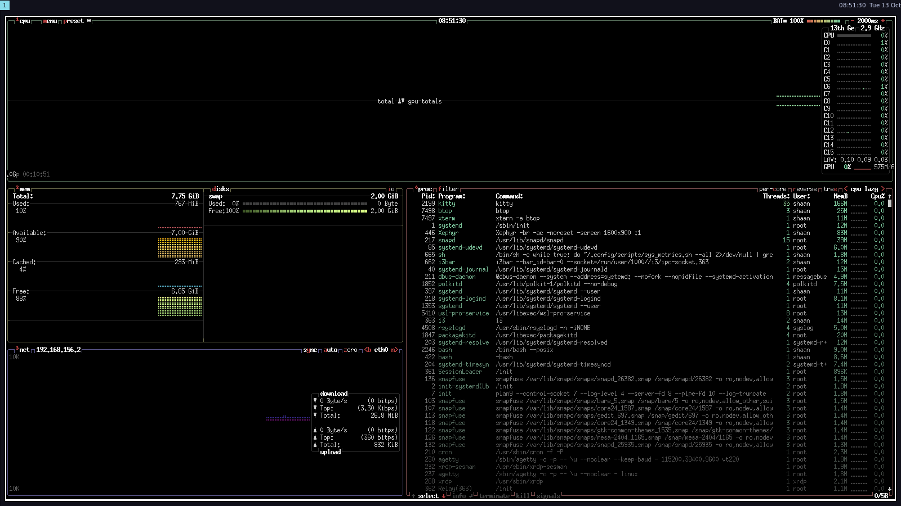
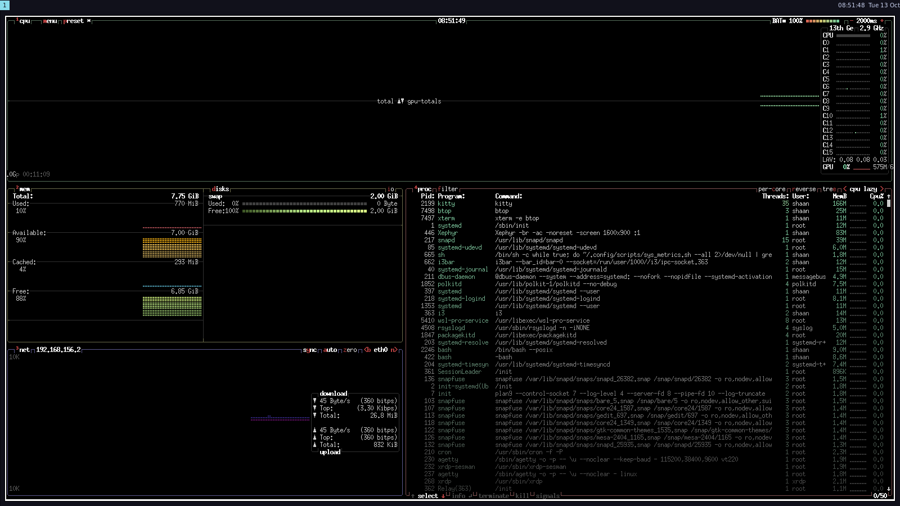
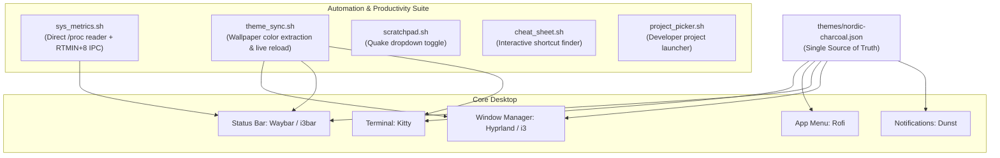

# 🌌 DeveloperDesktop

<div align="center">


**A keyboard-driven, minimalist developer cockpit designed with mathematical symmetry and zero bloat.**

[Features](#-core-features--bonus-highlights) • [Architecture](#-architecture) • [Keyboard Shortcuts](#-keyboard-shortcuts-reference) • [Installation](#-one-command-installation) • [Testing on Windows](#-testing-on-windows--wsl2)

</div>

---

## 🎯 Overview

**DeveloperDesktop** turns any Linux workstation into a cohesive, high-performance developer environment. Designed under strict minimalist principles:
* **8-Point Grid Symmetry:** Uniform 8px spacing across all tiled windows and floating panels.
* **Nordic Charcoal Spec:** Deep obsidian surfaces (`#11111b`) accented with a single crisp Ice Cyan (`#89dceb`).
* **Sub-Millisecond Performance:** Zero-lag GPU terminal rendering and direct `/proc` metric parsing.
* **Universal Parity:** Native Wayland support (Hyprland + Waybar) with drop-in X11 / Remote Desktop compatibility (i3).

---

## 📸 Visual Showcase

<div align="center">

### 🖥️ Tiled Developer Workstation (`i3` / `Hyprland` with 8px Gaps & `btop`)


###  Spotlight Application Launcher (`Rofi` in Nordic Charcoal)


</div>

---

## 🚀 Core Features & Bonus Highlights

| Feature | Requirement | Description |
| :--- | :---: | :--- |
| **Unified Visual Theme** | Core #1 | Single source of truth palette (`themes/nordic-charcoal.json`) shared across Terminal, Launcher, Status Bar, and Window Borders. |
| **Ergonomic Shortcuts** | Core #2 | Muscle-memory keybindings for terminal, launcher, workspaces, floating windows, and screenshots. |
| **Refreshable Metrics Script** | Core #3 | Custom Bash script (`scripts/sys_metrics.sh`) parsing `/proc/stat` and `/proc/meminfo` with laptop battery detection and automatic desktop storage fallback. |
| **Dynamic Theming Engine** | Bonus | `scripts/theme_sync.sh` extracts color harmony from wallpapers and broadcasts live IPC reload signals without restarting your session. |
| **Auto Workspace Routing** | Bonus | Declarative window rules allocating IDEs to WS 1, Browsers to WS 2, Communication to WS 4, and Media to WS 5. |
| **Interactive Status Bar** | Bonus | Clickable Waybar island modules (click CPU/RAM for `btop`, click Volume for `pavucontrol`, right-click for instant metric refresh). |
| **Quake Dropdown Terminal** | Bonus | `Super + ~` drops a floating terminal from the top of the monitor for quick git commands and tests. |
| **Searchable Cheatsheet** | Bonus | `Super + Shift + /` pops up a fuzzy searchable modal listing all system keybindings. |
| **Project Workspace Switcher**| Bonus | `scripts/project_picker.sh` fuzzy finds code repositories and launches VS Code + Kitty in a dedicated workspace. |
| **One-Command Installer** | Bonus | `install.sh` automatically detects Arch / Debian / Ubuntu / Fedora, backs up existing configs, and links dotfiles. |

---

## 📐 Architecture



---

## ⌨️ Keyboard Shortcuts Reference

> **Note on the `Super` key:** The `Super` key is the **Windows key (⊞)** on your keyboard!

| Shortcut | Action | Description |
| :--- | :--- | :--- |
| `Super + Return` | **Launch Terminal** | Opens GPU-accelerated Kitty terminal |
| `Super + Space` | **Application Finder** | Spotlight-style fuzzy app search via Rofi |
| `Super + W` | **Window Switcher** | Fuzzy search and jump between open windows |
| `Super + Q` | **Close Window** | Closes the currently active window |
| `Super + F` | **Toggle Fullscreen** | Expands focused window to full screen |
| `Super + V` | **Toggle Floating** | Detaches window from the tiling grid |
| `Super + ~` | **Quake Scratchpad** | Drops a terminal from the top edge |
| `Super + 1 .. 9` | **Switch Workspace** | Jump directly to Workspaces 1 through 9 |
| `Super + Shift + 1 .. 9` | **Move Window** | Move active window to target Workspace |
| `Super + Shift + S` or `Print` | **Screenshot Area** | Select a region and copy screenshot to clipboard |
| `Super + Ctrl + S` | **Screenshot Full** | Save full-screen capture to `~/Pictures/Screenshots` |
| `Super + Shift + /` | **Cheatsheet** | Opens interactive searchable shortcuts modal |
| `Super + Shift + E` | **Power Menu** | Lock, Suspend, Reboot, or Shutdown |

---

## 📦 One-Command Installation

To deploy this configuration on any Linux installation (Arch, Ubuntu, Debian, Fedora):

```bash
git clone https://github.com/ShaanAhamedM/DeveloperDesktop.git
cd DeveloperDesktop
chmod +x install.sh
./install.sh
```

The installer will:
1. Detect your distribution's package manager and install required dependencies.
2. Create a timestamped backup of your existing configs (`~/.config/backup_TIMESTAMP`).
3. Safely symlink the configuration files into `~/.config/`.
4. Deploy wallpapers and apply the unified Nordic Charcoal theme.

---

## 🧪 Testing on Windows / WSL2

You can run and experience this developer desktop right from Windows 11:

### 1. Test System Metrics Script
```powershell
wsl bash scripts/sys_metrics.sh --all
wsl bash scripts/sys_metrics.sh --json
```

### 2. Test Kitty Terminal on Windows Desktop (WSLg)
```powershell
wsl kitty
```

### 3. Full Desktop Experience via Remote Desktop (RDP)
Connect via Windows Remote Desktop (`mstsc.exe`) to `localhost:3390` to experience the full tiling window manager, status bar, and wallpaper in an isolated, high-resolution session.

---

## 📄 License

This project is licensed under the [MIT License](file:///D:/OpenSourceProjects/DeveloperDesktop/license). Built by **Shaan**.
